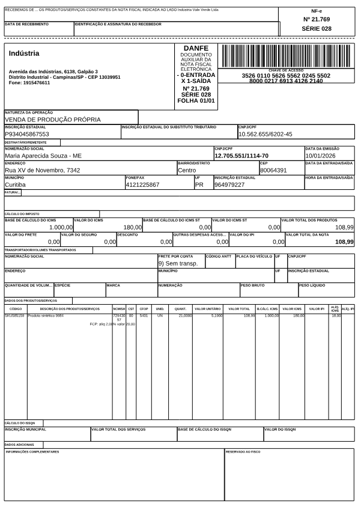
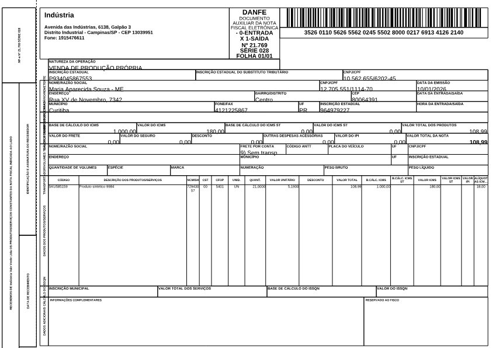
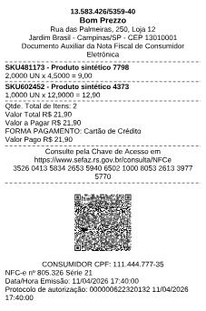
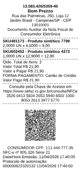
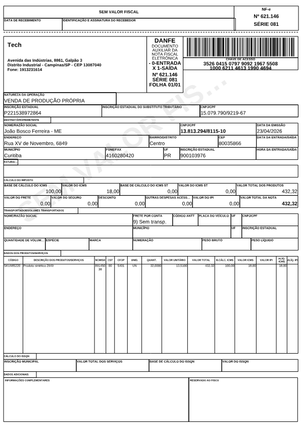
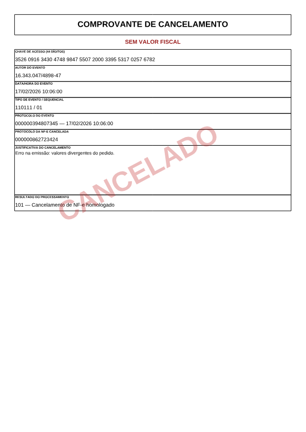

# danfe-br

[](https://github.com/hadagalberto/danfe-br/actions/workflows/ci.yml)
[](LICENSE)

**danfe-br** é uma biblioteca TypeScript (pura, sem dependências nativas) para
documentos fiscais eletrônicos brasileiros — **NF-e (modelo 55)** e
**NFC-e (modelo 65)** — que parseia o XML autorizado, valida o documento e
renderiza os documentos auxiliares oficiais em PDF: **DANFE** (retrato e
paisagem) e **DANFE NFC-e** (80 mm e 58 mm, com QR Code), além de saída
**ESC/POS** para impressoras térmicas.

> Status: **Marcos 1 a 5 concluídos** — modelo tipado, parser, validação,
> fábrica de fixtures, códigos de barras (Code 128 / QR Code), verificação
> da assinatura XMLDSig do `infNFe`, **DANFE retrato e paisagem**, **DANFE
> NFC-e 80/58 mm**, **ESC/POS**, composição de eventos (cancelamento e CC-e)
> e a **CLI `danfe`** (arquivo único, lote, `--layout`, `--logo`, `--json`,
> `--validate`). O build ESM também é verificado em um contexto de navegador.

## Galeria

Imagens geradas das rasterizações douradas dos testes (`npm run docs:images`):

<p align="center">
  
  
</p>
<p align="center"><em>DANFE retrato e paisagem (MOC 7.0 — Anexo II).</em></p>

<p align="center">
  
  
  
  
</p>
<p align="center"><em>NFC-e 80/58 mm, marca d'água de homologação e comprovante de cancelamento.</em></p>

## Instalação

```bash
npm install danfe-br
```

Requer **Node.js ≥ 20**. Funciona em Node e no navegador (TypeScript puro,
sem dependências nativas). Build dual: ESM + CJS.

## Uso

### Parse do XML autorizado

```ts
import { parseNFe, validateNFe } from 'danfe-br';

const proc = parseNFe(xmlDaNota); // nfeProc (com protocolo) ou NFe "raiz"

proc.nfe.chave; // chave de acesso (44 posições)
proc.nfe.ide.nNF; // número da nota
proc.nfe.det[0].imposto.icms; // grupo de ICMS tipado (união por CST/CSOSN)
proc.protNFe?.cStat; // 100 = uso autorizado
```

Aceita `nfeProc` e `NFe` (com ou sem protocolo). Eventos:

```ts
import { parseEventoNFe } from 'danfe-br';

const evento = parseEventoNFe(xmlDeEvento);
// raiz procEventoNFe, procEventoCancNFe (cancelamento, 110111)
// ou procCCeNFe (Carta de Correção, 110110)
evento.evento.infEvento.detEvento; // tipado por tpEvento
```

### Validação (reporta, nunca lança)

```ts
const resultado = validateNFe(proc);

resultado.valido; // sem erros?
resultado.problemas; // erros + avisos, com regra e cStat oficiais
resultado.situacaoProtocolo.autorizada; // cStat 100/150
resultado.situacaoProtocolo.semValorFiscal; // homologação/não autorizada
```

O que é validado neste marco (cada item cita a fonte oficial no código):

| Verificação                                             | Fonte oficial                                           |
| ------------------------------------------------------- | ------------------------------------------------------- |
| DV da chave de acesso (módulo 11)                       | MOC 7.0 — Visão Geral 2.2.6.2; regra B23-10 (cStat 253) |
| Consistência da chave com `ide`/emitente                | MOC 7.0 — Anexo I, regra A03-10 (cStat 502)             |
| CNPJ numérico **e alfanumérico** (ASCII−48, A=17..Z=42) | NT 2025.001 + RFB; MOC C02-10/E02-10 (cStat 207/208)    |
| CPF (rejeita zeros e dígitos repetidos)                 | MOC cStat 401/237 (NT 2012/003)                         |
| Recomputação de totais (vProd, vICMS, vST, ...)         | MOC 7.0 — Anexo I, regras W (cStat 531-609)             |
| Fórmula do vNF (W16-10, tolerância R$ 0,50)             | MOC 7.0 — Anexo I, cStat 610 (nota *3, NT 2012/003)     |
| Item: vProd = qCom × vUnCom (tolerância R$ 0,01)        | MOC cStat 629/630 (nota *4)                             |
| Item: vICMS = vBC × pICMS (CST 00/10/20/70)             | MOC regra N17-20, cStat 528                             |
| CST 51: vICMS = vICMSOp − vICMSDif                      | MOC regra N17-10, cStat 353                             |
| Situação do protocolo (100/150/110/301-303)             | MOC 7.0 — Anexo I, seções 4.4.1/4.4.3                   |
| Homologação → “SEM VALOR FISCAL”                        | MOC 7.0 — Anexo II                                      |

### Fábrica de fixtures (`danfe-br/fixtures`)

Gera XMLs sintéticos **realistas** (empresas fictícias, chaves com DV válidos,
totais recomputados que passam na validação) — útil para testes de
integrações:

```ts
import {
  montaNFe,
  montaNFeProc,
  nfeProcToXml,
  itemSintetico,
  protNFeSintetico,
  montaEvento,
  eventoToXml,
  cnpjSintetico,
} from 'danfe-br/fixtures';

const nfe = montaNFe({
  seed: 'minha-nota',
  itens: [
    itemSintetico({
      seed: 'item-1',
      icms: { grupo: 'ICMS00', orig: 0, cst: '00', modBC: 3, vBC: 1000, pICMS: 18, vICMS: 0 },
    }),
  ],
});
const xml = nfeProcToXml(montaNFeProc(nfe, protNFeSintetico(nfe)));
```

Determinística: a mesma `seed` produz os mesmos bytes.

### Códigos de barras (marco 2)

```ts
import { encodeCode128, encodeQrCode } from 'danfe-br';

const barcode = encodeCode128(nfe.chave); // Code 128C com fallback em B
barcode.larguras; // módulos barra/espaço para rasterização
barcode.larguraModulos; // largura sem zona de silêncio

const qr = encodeQrCode(urlConsultaNfce, { nivelCorrecao: 'M' });
qr.versao; // 1–40 (automaticamente a menor que caiba)
qr.mascara; // 0–7, escolhida pela menor penalidade N1–N4 (ISO/IEC 18004)
qr.modulos; // matriz [y][x], `true` = escuro
qr.paraSvg(4, 4); // SVG com zona de silêncio
```

Ambos são puro TS, sem dependências de runtime. Os testes decodificam os
símbolos gerados com decodificadores independentes (`@zxing/library` para
Code 128 e `jsQR` para QR), incluindo as 40 versões do QR.

### Verificação da assinatura XMLDSig (marco 2)

```ts
import { verificaAssinaturaNFe } from 'danfe-br';

const resultado = verificaAssinaturaNFe(xmlAutorizado);

resultado.valido; // DigestValue (C14N + SHA-1) e SignatureValue (RSA-SHA1) conferem?
resultado.erros; // razões da falha — nunca lança em assinatura inválida
resultado.detalhes.digestValido;
resultado.detalhes.assinaturaValida;
resultado.detalhes.certificado.bitsModulo; // chave RSA extraída do X.509
```

Perfil NF-e: C14N 1.0 sem comentários, SHA-1, RSA-SHA1 (PKCS#1 v1.5) e
certificado X.509 em `KeyInfo/X509Data/X509Certificate`. A cadeia ICP-Brasil
e a validade temporal do certificado **não** são avaliadas — apenas a
integridade criptográfica do `infNFe`.

### DANFE retrato (marco 3)

```ts
import { renderDanfe } from 'danfe-br';

const pdf: Uint8Array = await renderDanfe(proc, {
  logo: logoPngOuJpeg, // opcional (MOC §3.1.3)
  cancelada: false, // detectado automaticamente pelo evento 110111
  eventos: [eventoCancelamento], // opcional: procEventoNFe
});
```

O PDF é A4 retrato, com canhoto, cabeçalho com chave em Code 128C, todos os
quadros do Anexo II, tamanhos mínimos de fonte da MOC §3.7, paginação
automática de produtos com `FOLHA X/Y` nas folhas de continuação, transbordo
de informações complementares e marcas d'água (homologação → `SEM VALOR
FISCAL`, `CANCELADA`, `DENEGADA`, `CONTINGÊNCIA`). Posições e regras vêm do
[MOC 7.00 — Anexo II](https://www.confaz.fazenda.gov.br/legislacao/arquivo-manuais/moc7-anexo-ii-manual-especificacoes-tecnicas-danfe-codigo-barras.pdf),
citadas nos comentários de `src/render/`. A fonte embutida é a **DANFE Sans**
(derivada da Liberation Sans, SIL OFL 1.1 — ver `assets/fonts/`). O
`@pdf-lib/fontkit` é o acompanhante oficial do `pdf-lib` necessário para
incorporar fontes TrueType; é a única dependência de runtime além do próprio
`pdf-lib` e do parser XML.

### DANFE paisagem, NFC-e, ESC/POS e eventos (marco 4)

```ts
import { renderDanfe, renderDanfeNfce, toEscPos, renderEvento } from 'danfe-br';

// DANFE A4 paisagem — MOC 7.0 Anexo II §3.8.2 / Anexo III.04
const paisagem = await renderDanfe(proc, { layout: 'paisagem' });

// DANFE NFC-e térmico — QR Code lido de infNFeSupl/qrCode, chave em 11 blocos de 4
const cupom80 = await renderDanfeNfce(procNfce);
const cupom58 = await renderDanfeNfce(procNfce, { larguraMm: 58 });

// ESC/POS: comando nativo GS ( k para QR Code, PC860, corte parcial
const bytes = toEscPos(procNfce, { larguraMm: 80 });

// Comprovantes de eventos: carimbo CANCELADO e Carta de Correção
const cancelled = await renderEvento(procCancelamento);
const cce = await renderEvento(procCCe);
```

A NFC-e segue o
[Manual de Padrões Técnicos do DANFE-NFC-e e QR Code v5.1](https://dfe-portal.svrs.rs.gov.br/Nfce/Documentos)
(divisões I–IX, margens de 2 mm, QR de 25 × 25 mm com nível M/UTF-8) e o
[Manual de Especificações Técnicas do DANFE NFC-e e QR Code v5.0](https://dfe-portal.svrs.rs.gov.br/Nfce/Documentos),
com as URLs de download oficiais citadas em `src/render/nfce-conteudo.ts`. O
ESC/POS usa os comandos Epson documentados em `src/render/escppos.ts`; a
sequência de bytes é verificada com vetores exatos nos testes.

### CLI `danfe` (marco 5)

O pacote instala o binário `danfe`:

```bash
danfe nota.xml -o nota.pdf                         # arquivo único
danfe nota.xml --layout paisagem --logo logo.png -o nota.pdf
danfe nfce.xml --papel 58 -o cupom.pdf             # NFC-e detectada pelo modelo 65
danfe nota.xml --validate                          # só valida; exit 0/1
danfe notas/ -o pdfs/                              # lote: todos os .xml do diretório
danfe nota.xml --json                              # relatório estruturado no stdout
danfe --help
```

- `--layout` aceita `retrato` (padrão), `paisagem` e `nfce`; sem ele, notas
  modelo 65 usam NFC-e automaticamente. `--papel` escolhe 80 mm (padrão) ou
  58 mm.
- `--logo` aceita PNG ou JPEG (assinatura de arquivo verificada).
- `--json` imprime chave, modelo, número, série, emitente e o resultado completo
  da validação; pode ser combinado com a geração do PDF.
- `--validate` não gera PDF e retorna **1** se houver qualquer erro de
  validação (DV da chave, CNPJ/CPF, totais, protocolo), **0** caso contrário.
  Avisos (ex.: homologação "SEM VALOR FISCAL") não alteram o código.
- Códigos de saída: **0** sucesso, **1** documento/processamento inválido,
  **2** uso inválido (opção desconhecida, `--output` inadequado para lote etc.).
- O lote ignora arquivos que não sejam `.xml` e cria o diretório de saída se
  necessário. Sem `-o`, cada PDF é gravado ao lado do XML de origem.

### Testes de renderização

```bash
npm run golden   # regenera tests/golden/*.png (após mudanças de leiaute)
```

A suíte rasteriza os PDFs com `pdfjs-dist` + `@napi-rs/canvas` (binários para
todos os SOs), compara com imagens douradas com tolerância e verifica por
extração de texto que cada campo cai no seu quadro. `npm run docs:images`
copia as mesmas rasterizações para `docs/images/` (usadas neste README e no
README.en.md).

Há ainda um smoke test de navegador: `tests/browser-esm.test.ts` roda com
`happy-dom`, importa o **build ESM publicado** (`dist/index.js`) e renderiza um
DANFE e um NFC-e, validando a estrutura do PDF com `pdf-lib`. O binário é
exercitado por `tests/cli.test.ts`, inclusive com processos reais e códigos de
saída (0/1/2).

## Cobertura do modelo tipado

Layout **4.00** conforme os XSDs oficiais (vendados em [`schemas/`](schemas/)):

- `ide` (incluindo `NFref`), `emit`, `dest`;
- `det/prod` e `det/imposto`: **todos os grupos de ICMS** (CST 00, 02, 10, 15,
  20, 30, 40/41/50, 51, 53, 60, 61, 70, 90 + `ICMSPart` + `ICMSST`) e
  **todos os CSOSN** (101, 102/103/300/400, 201, 202/203, 500, 900), `IPI`
  (IPITrib/IPINT), `PIS`/`COFINS` (Aliq/Qtde/NT/Outr), `ICMSUFDest`, `II`,
  `ISSQN` por item e **IBS/CBS da Reforma Tributária (NT 2024.002 v1.10)**;
- `total` (`ICMSTot`, `ISSQNtot`, `retTrib`, `IBSCBSSelTot`);
- `transp` (transporta, `retTransp`, veículo, reboques, volumes com lacres);
- `cobr` (fatura e duplicatas), `pag` (todas as formas de pagamento, cartões,
  troco), `infAdic`, `infRespTec`, `autXML` e `infNFeSupl` (QR Code da NFC-e,
  em CDATA);
- protocolo `protNFe` e eventos (`procEventoNFe`, cancelamento e CC-e),
  incluindo o `detEvento` genérico (`xs:anyType`).

## Desenvolvimento

```bash
npm install        # dependências
npm run verify     # typecheck + lint + format + build + testes
npm run fixtures   # regenera o corpus em tests/fixtures/ (determinístico)
npm run golden     # regenera as imagens douradas em tests/golden/
npm run docs:images # regenera docs/images/ a partir de tests/golden/
```

- Testes: **vitest** — 277 testes, incluindo o corpus com 45 XMLs em
  `tests/fixtures/` (uma nota por CST/CSOSN, 10/60/120 itens, duplicatas,
  transporte, homologação, denegada, sem protocolo, CNPJ alfanumérico, DIFAL,
  ISSQN conjugado, IBS/CBS, 3 NFC-e's, cancelamento e CC-e), 15 testes da CLI e
  3 do build ESM em happy-dom.
- Finais de linha: **LF** (`.gitattributes`).
- CI: GitHub Actions em ubuntu/windows/macos × Node 20/22/24.

## Fontes oficiais

- [MOC 7.0 e anexos](https://www.confaz.fazenda.gov.br/legislacao/arquivo-manuais)
  (Ato COTEPE ICMS 69/20) — Visão Geral, Anexo I (leiaute e regras de
  validação) e Anexo II (DANFE, inclusive §3.8.2/Anexo III.04 paisagem).
- [Portal NFC-e da SVRS — Manuais](https://dfe-portal.svrs.rs.gov.br/Nfce/Documentos)
  — Manual de Padrões Técnicos do DANFE-NFC-e e QR Code v5.1 e Manual de
  Especificações Técnicas do DANFE NFC-e e QR Code v5.0.
- [Portal Nacional da NF-e](https://www.nfe.fazenda.gov.br) e
  [Portal DFe da SVRS](https://dfe-portal.svrs.rs.gov.br/NFe/Documentos)
  (schemas XSD PL_009q e notas técnicas 2024.002, 2025.001 etc.).
- XSDs oficiais vendados em [`schemas/`](schemas/README.md) com fonte e data.

## Licença

[MIT](LICENSE) © Hadagalberto Junior.
